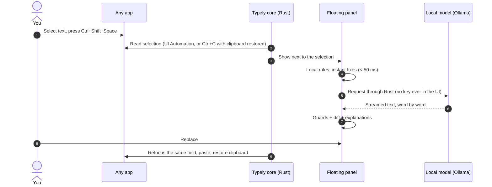

<div align="center">


# Typely

### Write better in every app. Your text stays on your computer.

Select text anywhere, press **Ctrl+Shift+Space**, and get a correction, rewrite or
translation in a floating panel. Click **Replace** and it goes straight back where you
were typing.

[](#-get-started)
[](https://tauri.app)
[](apps/desktop/src-tauri)
[](packages)
[](#-private-by-design)
[](#-quality)
[](docs/development/roadmap.md)
[](LICENSE)

<br />


</div>

---

## ✨ Why Typely

<table>
<tr>
<td width="33%" valign="top">

### 🔒 Private by design

Runs **on your machine** by default: built-in rules plus an optional local model through
[Ollama](https://ollama.com). Cloud AI stays **off** until you allow it globally **and**
approve each provider. The engine enforces this itself, before any network call.

</td>
<td width="33%" valign="top">

### ⚡ Fast, light, out of the way

Local fixes show in **under 50 ms**. A warm local model finishes a short message in
**about 2 seconds**, streaming as it writes. Nothing is loaded at startup, in the background
or while you type, and there's **no telemetry**.

</td>
<td width="33%" valign="top">

### 🌍 Works where you write

One shortcut for any app: editors, browsers, chat boxes. Typely reads the selection
through **Windows UI Automation**, pastes back with **undo intact**, and restores your
clipboard. **French, English and Arabic** out of the box.

</td>
</tr>
</table>

## 🧠 Eight writing actions

| Action                 | What it does                                           |
| ---------------------- | ------------------------------------------------------ |
| ✅ **Correct**         | Spelling, grammar, punctuation, keeping your own words |
| ✍️ **Rewrite**         | Same meaning, smoother sentences                       |
| 💼 **Professional**    | Polished tone for e-mails and reports                  |
| ✂️ **Make concise**    | Shorter, without losing the point                      |
| 😊 **Friendly**        | Warmer, more casual tone                               |
| 💡 **Improve clarity** | Easier to read and understand                          |
| 🌐 **Translate**       | To English, French, Arabic, Spanish or German          |
| 🤖 **Improve prompt**  | Sharper, clearer prompts for AI assistants             |

Every result comes with a **word-level diff**, **plain-language explanations**, and
**safety warnings** if the model changes the language, drops a link or a number, or goes
off-task.

## 🔍 How it works



**Three layers, best of each:**

1. **Local rules and spell checking**: deterministic, high-precision fixes in milliseconds:
   typos, repeated words, spacing and capitalisation, French typography, Arabic punctuation.
   A bundled English dictionary (US and British spellings) and the Windows spell checker
   catch misspellings even when the model misses them, for every action: a rewrite or a
   translation starts from the spell-fixed text, and the model's output is checked too. They
   fix only typo-shaped, unambiguous ones ("imlpressive" → "impressive") and leave jargon and names alone.
2. **LanguageTool** (optional, self-hostable): deeper grammar checks. Supported by the
   engine; the desktop settings screen for it is still to come.
3. **AI model**: local (Ollama) or cloud (OpenAI, Anthropic, Gemini, any OpenAI-compatible
   server), with automatic retry and fallback between providers.

## 🛡️ Private by design

| Guarantee                                   | How it's enforced                                                                                                 |
| ------------------------------------------- | ----------------------------------------------------------------------------------------------------------------- |
| Nothing leaves your PC unless you allow it  | Engine-level consent gate: global switch **and** per-provider approval, checked before any request                |
| API keys can't leak to the UI               | Stored in the **Windows Credential Manager**; write-only from the UI; attached by Rust per endpoint               |
| A key can't be redirected to another server | Each key is bound to the host it was entered for, and never sent over plain HTTP to a remote host                 |
| Password fields are never read              | UI Automation `IsPassword` check; capture refused                                                                 |
| Your clipboard is respected                 | Saved and restored around every copy and paste; Typely's temporary content is marked to stay out of Win+V history |
| Text never lands in the wrong place         | Replace re-focuses the original window **and field**, verifies it, or pastes nothing                              |
| Prompt injection can't hijack a correction  | Off-task model output is discarded in favour of the local result (`ai_rejected`)                                  |

Full analysis in the [threat model](docs/security/threat-model.md).

## 📊 Performance

Measured on a mid-range laptop (Intel i7-1355U, 32 GB, Iris Xe iGPU), Windows 11:

| Step                                         | Time / size                                        |
| -------------------------------------------- | -------------------------------------------------- |
| Instant local fixes                          | **24–47 ms**                                       |
| First AI words, warm local model (gemma3:1b) | **~0.5–1 s**                                       |
| Complete correction, short message, warm     | **1.4–2.1 s**                                      |
| Quality rewrite with gemma3:4b               | ~13–18 s, unloaded right after                     |
| App binary                                   | **5.2 MB**                                         |
| Model memory when idle                       | **0**: loaded only on demand, released after 5 min |

Details: [benchmark](docs/development/ollama-benchmark.md) ·
[desktop test log](docs/development/desktop-testing.md)

## 🚀 Get started

**Requirements:** Windows 11 (Windows 10 not tested yet), [Node.js](https://nodejs.org) ≥ 24, the
[Rust toolchain and MSVC Build Tools](docs/development/setup.md#toolchain-requirements-for-phase-2).
Ollama is optional.

```bash
npm install
```

Run the desktop app:

```bash
npm run tauri dev
```

Build the release executable (`target/release/typely.exe`):

```bash
npm run tauri build
```

Then select text anywhere and press **Ctrl+Shift+Space**. Without a model, Typely uses its
local rules. For AI corrections that stay on your PC, open **Local AI** in Typely and click
**Use recommended setup**: `gemma3:1b` for fast corrections, `gemma3:4b` for rewrites and
translation.

<details>
<summary><b>Try the engine from the terminal</b></summary>

Local rules only:

```bash
npm run typely -- fix "i think teh the report is ready , can you check it?it is due tomorrow"
```

With a local Ollama model:

```bash
TYPELY_PROVIDER=ollama TYPELY_MODEL=gemma3:1b npm run typely -- professional "hey can u send me the file asap"
```

With a cloud provider (requires explicit consent):

```bash
TYPELY_PROVIDER=openai TYPELY_MODEL=<model-id> TYPELY_CLOUD_CONSENT=1 OPENAI_API_KEY=... npm run typely -- translate --to ar "See you tomorrow at the meeting"
```

Options: `--mode local|ai|hybrid`, `--lang fr`, `--json`, `--check`. See
[scripts/typely-cli.ts](scripts/typely-cli.ts).

</details>

<details>
<summary><b>Use the engine in your own code</b></summary>

```ts
import { CorrectionEngine, endpointsFromSettings } from "@typely/correction-engine";
import { DirectTransport } from "@typely/provider-adapters";

const settings = {
  providers: [{ id: "local", kind: "ollama", label: "Ollama", model: "gemma3:1b" }],
};
const transport = new DirectTransport({
  endpoints: endpointsFromSettings(settings),
  getSecret: async () => undefined, // resolve keys from a secure store
});
const engine = new CorrectionEngine({ settings, transport });

const result = await engine.run(
  { operation: "fix", text: "Je suis allé a la réunion hier." },
  { onLocalPreview: (p) => console.log("instant:", p.corrected_text) },
);
// result.corrected_text, result.explanation, result.changes (diff), result.warnings
```

`DirectTransport` is for trusted contexts (Node, an extension service worker). The desktop
app uses `TauriTransport`, which hands every request to Rust.

</details>

## 🏗️ Architecture

One TypeScript engine, shared by every surface; a small Rust core as the trusted executor.


Decisions are documented as ADRs in [decisions.md](docs/architecture/decisions.md), with
the full design in [architecture.md](docs/architecture/architecture.md).

## 🧪 Quality

- **221 automated tests**: 195 TypeScript (Vitest) and 26 Rust, plus contract tests that
  pin the TypeScript and Rust sides to the same fixtures.
- **Strict everywhere**: TypeScript strict mode, Biome lint and format, `clippy -D warnings`,
  `rustfmt`.
- **One command** runs it all:

```bash
npm run check
```

## ✅ Tested where it matters

| Where                              | Capture        | Replace |
| ---------------------------------- | -------------- | ------- |
| Notepad (Windows 11)               | UI Automation  | ✅      |
| Brave, text input                  | UI Automation  | ✅      |
| Web page inside an Electron app    | UI Automation  | ✅      |
| Edge, Chrome, Word, Outlook, Teams | Not tested yet | —       |

Every result is from a real run, logged in the
[desktop test log](docs/development/desktop-testing.md).

## 🗺️ Roadmap

- [x] **Shared core**: engine, 8 actions, fr/en/ar, local rules, guards, 5 AI providers
- [x] **Local AI**: two-tier Ollama setup, 5-minute warm window, streaming, injection defence
- [x] **Windows app**: shortcut, floating panel, Replace, settings, consent, keyring
- [ ] **More apps verified**: Office, Teams, Edge/Chrome, admin-level apps
- [ ] **Browser extension** (Chrome, Edge): inline suggestions, one-click fixes
- [ ] **Installer** with code signing and auto-update

Full checklist: [roadmap.md](docs/development/roadmap.md).

## 📁 Repository layout

```
apps/
  desktop/             Windows app · src/ (React) + src-tauri/ (Rust)
packages/
  schemas/             shared data contracts (Zod)
  provider-adapters/   AI providers, transports, retry/fallback, LanguageTool
  correction-engine/   detection, rules, prompts, guards, diff
tests/integration/     cross-package tests
scripts/               developer CLI and benchmarks
docs/                  architecture, decisions, security, roadmap
```

## 🤝 Contributing and security

Typely is proprietary software ([LICENSE](LICENSE)). The source is public to read;
contributions are welcome under the terms in [CONTRIBUTING.md](CONTRIBUTING.md). To report a
vulnerability privately, see [SECURITY.md](SECURITY.md).

---

<div align="center">

**Typely**: fix it where you write it.

© 2026 Mohamed Amine EL Khattabi. All rights reserved. Proprietary software; see [LICENSE](LICENSE).
Third-party components: [THIRD_PARTY_NOTICES.md](THIRD_PARTY_NOTICES.md).

</div>
