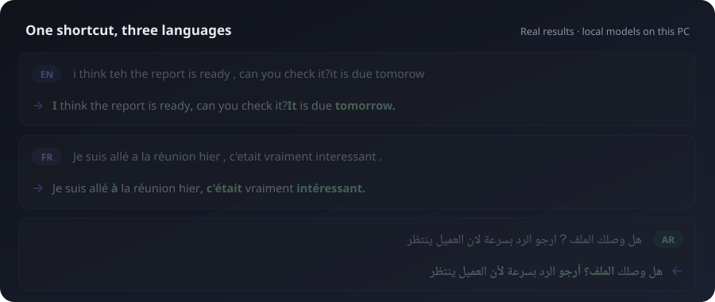
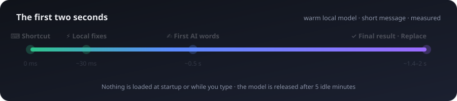
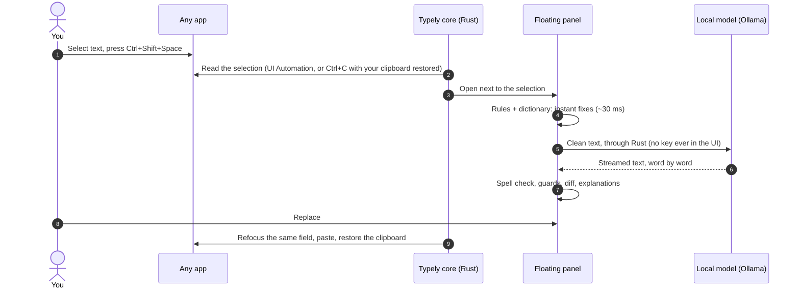
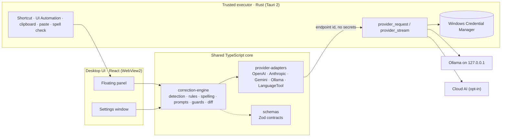

<div align="center">


# Typely


**The writing assistant that works in every app and keeps your text on your computer.**

[](#get-started-in-3-steps)
[](https://tauri.app)
[](apps/desktop/src-tauri)
[](packages)
[](#private-by-design)
[](#built-to-last)
[](docs/development/roadmap.md)
[](LICENSE)

[**See it**](#see-it-in-action) · [**Languages**](#fluent-in-english-french-and-arabic) ·
[**Speed**](#fast-enough-to-feel-instant) · [**Privacy**](#private-by-design) ·
[**Get started**](#get-started-in-3-steps) · [**FAQ**](#faq)

<br />



</div>

> [!TIP]
> **How it works, in one line:** select text in any app → press
> <kbd>Ctrl</kbd>+<kbd>Shift</kbd>+<kbd>Space</kbd> → click **Replace**. No copy-paste, no
> browser tab, no account.

---

## Why people pick Typely

<table>
<tr>
<td width="33%" valign="top">


### Your words stay yours

Runs **on your PC** by default: built-in rules, a bundled dictionary and an optional local
AI model through [Ollama](https://ollama.com). Cloud AI stays **off** until you turn it on
**and** approve each provider. No account, no telemetry.

</td>
<td width="33%" valign="top">


### Instant, then smart

Typos are fixed **in about 30 ms**, before any AI is involved. A local model then polishes
the text, **streaming as it writes**, in about **2 seconds** for a short message. Nothing
loads at startup or while you type.

</td>
<td width="33%" valign="top">


### Everywhere you type

One shortcut for **any app**: editors, browsers, chat boxes, web apps. Typely reads your
selection, pastes the result back **with undo intact**, and restores your clipboard.
**English, French and Arabic**, right to left included.

</td>
</tr>
</table>

## See it in action

Eight actions, one panel. Every example below is a **real output** from Typely with free
local models (gemma3:1b for Correct, gemma3:4b for the rest), not a mock-up. Click one to
open it.

<details open>
<summary>&nbsp; <b>Correct</b>: typos, grammar and punctuation, keeping your words</summary>

| You wrote                                                            | Typely wrote                                                       |
| -------------------------------------------------------------------- | ------------------------------------------------------------------ |
| i think teh the report is ready , can you check it?it is due tomorow | I think the report is ready, can you check it? It is due tomorrow. |

</details>

<details>
<summary>&nbsp; <b>Professional</b>: polished tone for e-mails and reports</summary>

| You wrote                                                                                                 | Typely wrote                                                                                        |
| --------------------------------------------------------------------------------------------------------- | --------------------------------------------------------------------------------------------------- |
| hey can u send me the file asap, the client is waiting and its kinda urgent                               | Please send me the file as soon as possible. The client is waiting and this is urgent.              |
| Make it commercial repo make it very interesting with catchy readme file imlpressive dynamic and all that | Develop a commercial repo with a compelling README, dynamic features, and an engaging presentation. |

The second one is the request that started this README. The typo "imlpressive" was fixed
by the local dictionary before the model even saw it.

</details>

<details>
<summary>&nbsp; <b>Make concise</b>: shorter, without losing the point</summary>

| You wrote                                                                                                                                         | Typely wrote                                                                       |
| ------------------------------------------------------------------------------------------------------------------------------------------------- | ---------------------------------------------------------------------------------- |
| I just wanted to reach out to let you know that I think we should probably consider moving the meeting to a later date if that works for everyone | I wanted to suggest moving the meeting to a later date if that works for everyone. |

</details>

<details>
<summary>&nbsp; <b>Friendly</b>: warmer, more human</summary>

| You wrote                                                                       | Typely wrote                                                                                                                                     |
| ------------------------------------------------------------------------------- | ------------------------------------------------------------------------------------------------------------------------------------------------ |
| Your request has been received. It will be processed within five business days. | Okay, just letting you know your request has been received and we’re working on it. You can expect it to be processed within five business days. |

</details>

<details>
<summary>&nbsp; <b>Translate</b>: English, French, Arabic, Spanish, German</summary>

| You wrote                                                 | Typely wrote                                                     |
| --------------------------------------------------------- | ---------------------------------------------------------------- |
| Je vous envoie le rapport demain matin, avant la réunion. | I’m sending you the report tomorrow morning, before the meeting. |
| See you tomorrow at the meeting.                          | نتقابل غدًا في الاجتماع.                                           |

</details>

<details>
<summary>&nbsp; <b>Improve prompt</b>: clearer requests for AI assistants</summary>

| You wrote                                         | Typely wrote                                                 |
| ------------------------------------------------- | ------------------------------------------------------------ |
| write me something about our new app for linkedin | Please write a marketing blurb for our new app for LinkedIn. |

</details>

Also in the panel: **Rewrite** (smoother, same meaning) and **Improve clarity**.
Every result shows a **word-level diff**, **plain-language explanations**, and a
**warning** if the AI changed the language, dropped a link or a number, or went off-task.

## Fluent in English, French and Arabic

<div align="center">

</div>

Language is detected automatically, even for mixed text. French typography rules, Arabic
punctuation (`،` `؛` `؟`) and right-to-left text are handled natively.

## Fast enough to feel instant

<div align="center">

</div>

<details>
<summary><b>The measurements</b> (Intel i7-1355U laptop, 32 GB, integrated graphics)</summary>

| Step                                         | Time / size                                               |
| -------------------------------------------- | --------------------------------------------------------- |
| Instant local fixes (rules + dictionary)     | **24–47 ms**                                              |
| First AI words, warm local model (gemma3:1b) | **~0.5–1 s**                                              |
| Complete correction of a short message, warm | **1.4–2.1 s**                                             |
| Rewrite or translation with gemma3:4b        | ~8–18 s, released from memory right after                 |
| App size                                     | **5.2 MB**                                                |
| AI model memory while idle                   | **none**: loaded on demand, released after 5 idle minutes |

Sources: [benchmark](docs/development/ollama-benchmark.md) ·
[desktop test log](docs/development/desktop-testing.md).

</details>

## Under the hood



**Three layers, each doing what it's best at:**

1. **Rules and spell checking**, in milliseconds: typos, repeated words, spacing,
   capitalisation, number agreement ("a lot of issue" → "a lot of issues"), French
   typography and Arabic punctuation. A bundled English dictionary
   (US and British spellings) and the Windows spell checker catch misspellings the AI would
   miss, for **every** action. Only clear, typo-shaped fixes are automatic
   ("imlpressive" → "impressive"); names and jargon are left alone.
2. **Grammar checker** (optional): thousands of English and French rules from LanguageTool,
   run on your PC, started when you use Typely and stopped when idle. Only clear-cut grammar
   fixes are applied automatically; style and uncertain cases are shown as suggestions.
3. **AI**: local (Ollama) or cloud (OpenAI, Anthropic, Gemini, any OpenAI-compatible server),
   with automatic retry and fallback between providers.

<details>
<summary><b>Architecture diagram</b></summary>

One TypeScript engine shared by every surface; a small Rust core as the trusted executor.



Every decision is recorded as an ADR in [decisions.md](docs/architecture/decisions.md);
the full design is in [architecture.md](docs/architecture/architecture.md).

</details>

## Private by design

> [!IMPORTANT]
> By default **nothing leaves your computer**. Cloud AI needs two explicit switches: the
> global "Allow cloud processing" **and** your approval of that specific provider. The
> engine checks both before any request, so a UI bug can't send your text by accident.

| Guarantee                           | How it's enforced                                                                                                 |
| ----------------------------------- | ----------------------------------------------------------------------------------------------------------------- |
| API keys can't leak to the UI       | Kept in the **Windows Credential Manager**; the UI can store a key but never read it back                         |
| A key can't be redirected           | Each key is bound to the server it was entered for, never sent over plain HTTP to a remote host                   |
| Password fields are never read      | Checked through UI Automation (`IsPassword`); capture is refused                                                  |
| Your clipboard is respected         | Saved and restored around every copy and paste; Typely's temporary content is marked to stay out of Win+V history |
| Text lands in the right place       | Replace re-focuses the original window **and field**, verifies it, or pastes nothing                              |
| Prompt injection can't hijack a fix | Off-task AI output ("ignore your instructions and…") is discarded for the local result                            |
| No telemetry                        | Diagnostics stay in a local log, and never contain your text                                                      |

The full analysis is in the [threat model](docs/security/threat-model.md).

## Shortcuts

| Keys                                              | Action                                          |
| ------------------------------------------------- | ----------------------------------------------- |
| <kbd>Ctrl</kbd>+<kbd>Shift</kbd>+<kbd>Space</kbd> | Open Typely on the selected text (configurable) |
| <kbd>Ctrl</kbd>+<kbd>Enter</kbd>                  | Replace the selection with the result           |
| <kbd>Esc</kbd>                                    | Cancel the request, or close the panel          |
| <kbd>Ctrl</kbd>+<kbd>Z</kbd> (in your app)        | Undo a replacement                              |

## Get started in 3 steps

**1. Install the tools** (Windows 11): [Node.js](https://nodejs.org) ≥ 24, plus the
[Rust toolchain and MSVC Build Tools](docs/development/setup.md#toolchain-requirements-for-phase-2).

**2. Install and run:**

```bash
npm install
```

```bash
npm run tauri dev
```

**3. Select text anywhere and press <kbd>Ctrl</kbd>+<kbd>Shift</kbd>+<kbd>Space</kbd>.**

> [!NOTE]
> Without an AI model, Typely already fixes typos with its rules and dictionary. For AI
> that stays on your PC, install [Ollama](https://ollama.com), then open **Local AI** in
> Typely and click **Use recommended setup**: `gemma3:1b` for fast corrections, `gemma3:4b`
> for rewrites and translation.

<details>
<summary><b>Build the release executable</b></summary>

```bash
npm run tauri build
```

The result is `target/release/typely.exe` (about 5 MB). There's no installer yet.

</details>

<details>
<summary><b>Try the engine from a terminal</b></summary>

Local rules and dictionary only:

```bash
npm run typely -- fix "i think teh the report is ready , can you check it?it is due tomorow"
```

With a local Ollama model:

```bash
TYPELY_PROVIDER=ollama TYPELY_MODEL=gemma3:1b npm run typely -- professional "hey can u send me the file asap"
```

With a cloud provider (requires explicit consent):

```bash
TYPELY_PROVIDER=openai TYPELY_MODEL=<model-id> TYPELY_CLOUD_CONSENT=1 OPENAI_API_KEY=... npm run typely -- translate --to ar "See you tomorrow at the meeting"
```

Options: `--mode local|ai|hybrid`, `--lang fr`, `--json`, `--check`. See
[scripts/typely-cli.ts](scripts/typely-cli.ts).

</details>

<details>
<summary><b>Use the engine in your own code</b></summary>

```ts
import { CorrectionEngine, endpointsFromSettings } from "@typely/correction-engine";
import { DirectTransport } from "@typely/provider-adapters";

const settings = {
  providers: [{ id: "local", kind: "ollama", label: "Ollama", model: "gemma3:1b" }],
};
const transport = new DirectTransport({
  endpoints: endpointsFromSettings(settings),
  getSecret: async () => undefined, // resolve keys from a secure store
});
const engine = new CorrectionEngine({ settings, transport });

const result = await engine.run(
  { operation: "fix", text: "Je suis allé a la réunion hier." },
  {
    onLocalPreview: (p) => console.log("instant:", p.corrected_text),
    onPartialText: (text) => console.log("streaming:", text),
  },
);
// result.corrected_text, result.explanation, result.changes (diff), result.warnings
```

`DirectTransport` is for trusted contexts (Node, an extension service worker). The desktop
app uses `TauriTransport`, which hands every request to Rust.

</details>

## Tested where it matters

| Where                              | Reads the selection via | Replace |
| ---------------------------------- | ----------------------- | ------- |
| Notepad (Windows 11)               | UI Automation           |         |
| Brave, text input                  | UI Automation           |         |
| A web page inside an Electron app  | UI Automation           |         |
| Edge, Chrome, Word, Outlook, Teams | Not tested yet          |         |

Every verified entry comes from a real run, logged in the
[desktop test log](docs/development/desktop-testing.md).

## Built to last

- **234 automated tests**: 205 TypeScript (Vitest) and 29 Rust, plus contract tests that keep
  the TypeScript and Rust sides in sync.
- **Strict everywhere**: TypeScript strict mode, Biome, `clippy -D warnings`, `rustfmt`.
- **Precision checked on real text**: on 20,000 words of docs and code, every automatic
  spelling fix was a real typo.
- **One command** runs everything:

```bash
npm run check
```

## Roadmap

- [x] **Shared engine**: 8 actions, fr/en/ar, rules, spell checking, guards, 5 AI providers
- [x] **Local AI**: two-model Ollama setup, warm window, streaming, prompt-injection defence
- [x] **Windows app**: shortcut, floating panel, Replace, settings, consent, keyring
- [ ] **More apps verified**: Office, Teams, Edge/Chrome, administrator apps
- [ ] **Browser extension** (Chrome, Edge): suggestions as you type, one-click fixes
- [ ] **Installer** with code signing and automatic updates

The full checklist is in [roadmap.md](docs/development/roadmap.md).

## FAQ

<details>
<summary><b>Is my text sent anywhere?</b></summary>

Not by default. Rules, the dictionary and the Windows spell checker run on your PC, and a
local Ollama model runs on your PC too. Cloud AI is only used if you allow cloud processing
**and** approve that provider, and then only the text you selected is sent.

</details>

<details>
<summary><b>Do I need a powerful computer or a GPU?</b></summary>

No. Typely itself is a 5 MB app. The recommended `gemma3:1b` model runs on an ordinary
laptop's integrated graphics. Machines with less than 24 GB of memory get the small model
only.

</details>

<details>
<summary><b>Does it cost anything?</b></summary>

Typely uses no paid service by default: local rules, a bundled dictionary and free local
models. If you add a cloud provider, that provider's own pricing applies to your API key.

</details>

<details>
<summary><b>Which apps does it work in?</b></summary>

It's designed for any app where you can select text. So far it has been verified in
Notepad, a Brave text field and an Electron app's web view (see the table above). Apps
running as administrator can't receive input from a normal app; Windows blocks that.

</details>

<details>
<summary><b>Why was the first correction slower?</b></summary>

The first AI request loads the model (about 2–4 s). It then stays ready for 5 minutes, so
follow-up corrections take about 2 s. The dictionary also loads on first use (about 0.1 s).

</details>

<details>
<summary><b>Can it change my meaning or invent things?</b></summary>

Correct only fixes errors, and Typely checks the AI's answer. If it changes the language,
drops a link or a number, or rewrites far more than a correction should, you get a warning,
or the AI answer is discarded for the local result. Nothing is replaced until you click
**Replace**.

</details>

## Repository layout

```
apps/
  desktop/             Windows app · src/ (React) + src-tauri/ (Rust)
packages/
  schemas/             shared data contracts (Zod)
  provider-adapters/   AI providers, transports, retry/fallback, LanguageTool
  correction-engine/   detection, rules, spelling, prompts, guards, diff
tests/integration/     cross-package tests
scripts/               developer CLI, benchmarks, word-list builder
docs/                  architecture, decisions, security, roadmap
```

## Contributing and security

Typely is proprietary software ([LICENSE](LICENSE)). The source is public to read, and
contributions are welcome under the terms in [CONTRIBUTING.md](CONTRIBUTING.md). Please
report vulnerabilities privately, as described in [SECURITY.md](SECURITY.md).

---

<div align="center">

**Typely**: fix it where you write it.

© 2026 Mohamed Amine EL Khattabi. All rights reserved. Proprietary software; see
[LICENSE](LICENSE). Third-party components: [THIRD_PARTY_NOTICES.md](THIRD_PARTY_NOTICES.md).

</div>
